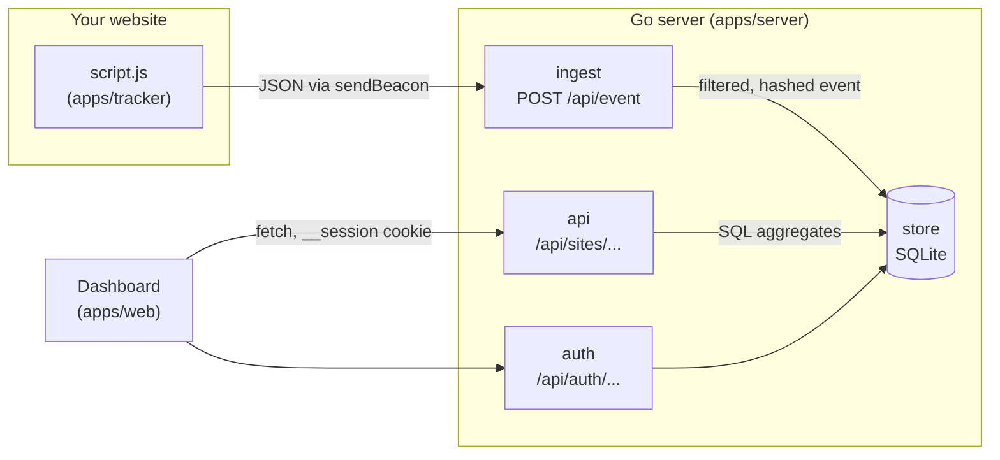
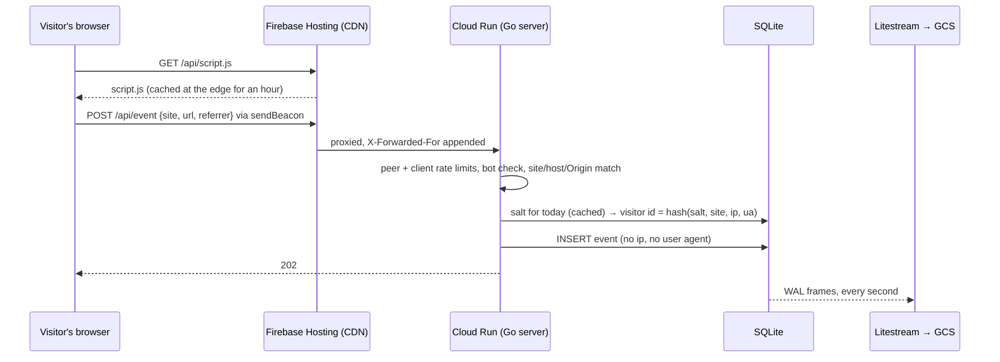
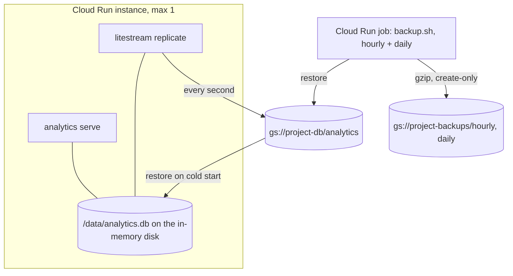

# Architecture

> **TL;DR** — There are three programs. A **tracking script** (TypeScript, ~1 KB) runs on your
> site and posts events. A **Go server** filters them, hashes the visitor anonymously and writes
> them to **SQLite**, then answers stats queries. A **React dashboard** shows the results. The Go
> binary embeds the script and the database migrations, so one binary plus one database file is
> the whole backend.

This page is a map, not an atlas. It tells you where things live and what must stay true. It
names files and types instead of linking them, so use your editor's search. For vocabulary
(visitor, visit, salt), read [docs/concepts.md](docs/concepts.md) first.

## Bird's-eye view



**Write path.** The browser loads `GET /api/script.js` and sends one `POST /api/event` per page
view or custom event. The server checks rate limits, drops bots, validates that the site, URL and
`Origin` belong together, strips the URL to host and path, looks up the country, computes the
daily visitor hash, and inserts one row. The IP address and user agent are used only in memory.

**Read path.** The dashboard asks for `/api/sites/{id}/stats`, `/breakdown`, `/heatmap` and
`/realtime`. These run aggregate SQL over the `events` table. Visits, bounces and durations are
computed at query time from `session_id`. Nothing is pre-aggregated.

**Deployment shape.** The dashboard is static files. It must be served from the same origin as
`/api`, so the session cookie and CSRF model work. In production, Firebase Hosting serves the
dashboard and rewrites `/api/**` to one Cloud Run instance. Litestream streams the SQLite file to
GCS. See [docs/guides/deploy-gcp.md](docs/guides/deploy-gcp.md).

### A page view, end to end



The IP address exists only inside the request: it keys the rate limiters, resolves to a country
and goes into the hash. Nothing writes it down. [docs/privacy.md](docs/privacy.md) lists every
stored field, and [docs/operations/bots.md](docs/operations/bots.md) lists the checks in order.

### Where the data lives



- The instance is the single writer, so `max_instance_count = 1`. Scale to zero is fine: the
  first request waits for the restore (a second or two).
- The replica is the primary durability mechanism. The standalone backup files defend against a
  damaged or deleted replica. With `require_replica = true`, an empty replica stops the instance
  and fails the backup job instead of starting fresh. The
  [runbook](docs/operations/runbook.md) has the restore playbook.
- Self-hosters get the same binary and scripts in `docker-compose.yml`, with any Litestream
  target (S3, GCS, a local path) or none.

What the server defends against, and what it does not, is in the
[threat model](SECURITY.md#threat-model).

## Codemap

### `apps/server`: Go module

| Package | What lives there |
|---|---|
| `cmd/analytics` | `main.go`: the binary. Subcommands `serve` (default), `sites add|list`, `events purge`, `seed`, `version`. Starts the retention loop and graceful shutdown |
| `cmd/loadtest` | Ingest load generator |
| `internal/config` | `Load()` reads every environment variable. The single source of configuration |
| `internal/server` | `New()` wires all routes and middleware. Start reading here. `sizeguard.go` pauses ingestion when `MAX_DATABASE_MB` is exceeded |
| `internal/ingest` | `Handler` for `POST /api/event`. The abuse checks in order, `isBot`, `buildEvent` (validation and normalisation), `cleanText`, prop parsing |
| `internal/visitor` | `Hasher.ID`: SHA-256 of daily salt, site id, IP and user agent, truncated to 63 bits |
| `internal/geo` | `Locator.Country`: local MaxMind/DB-IP lookup. Returns `""` without a database |
| `internal/httpx` | `ClientIP` and `PeerIP` (`X-Forwarded-For` with `PROXY_HOPS`), `RateLimiter`, `ReadJSON` and `WriteJSON` |
| `internal/auth` | `Service`: GitHub OAuth (`github.go`), sessions, `Require` middleware, the `DEV_LOGIN` shortcut (`dev.go`). A `Provider` interface leaves room for more identity providers |
| `internal/api` | `API.Register`: sites CRUD, purge (`api.go`), goals and goal stats (`goals.go`), CSV export (`export.go`), and stats, breakdown, heatmap and realtime handlers with query parsing (`stats.go`) |
| `internal/store` | All SQL. `store.go` opens SQLite (WAL) and runs `migrations/*.sql`. `events.go` inserts events and assigns sessions. `stats.go` holds `Summary`, `Timeseries`, `Breakdown` and `Dimensions`. `filter.go` turns `Filters` into SQL. `goals.go` holds goal CRUD and `GoalStats`. `sites.go` (with `sitecache.go`), `users.go` |
| `internal/text` | `Clean` and `Truncate`: how ingest cleans browser strings before storing them, shared with goals so a goal typed as sent matches |
| `internal/script` | Embeds `script.js` (built from `apps/tracker`) and serves it gzipped with an `ETag` |
| `internal/devdata` | Synthetic traffic profiles for `analytics seed` |

### `apps/tracker`: tracking script

`src/core.ts` holds all the logic (`init`, `pageview`, `track`, SPA history hooks, click handling
for outbound links and `data-mlz-event`). `src/index.ts` reads the `<script>` tag's `data-*`
attributes and exposes `window.mlz`. esbuild bundles it into
`apps/server/internal/script/script.js`, which is committed.

### `apps/web`: dashboard

React 19, Vite, Tailwind v4, shadcn/ui, TanStack Query and React Router. `src/main.tsx` holds the
routes, `src/lib/api.ts` the typed API client, and `src/lib/use-scope.ts` the URL-held view state.
See [docs/development/dashboard.md](docs/development/dashboard.md).

### Everything else

| Path | What |
|---|---|
| `apps/demo` | Static demo site for `make dev` |
| `infra/docker` | `Dockerfile` (static binary, DB-IP database, Litestream), `entrypoint.sh` (Litestream restore and replicate, `REQUIRE_REPLICA`), `docker-compose.yml` (hardened; settings from `.env`, template `.env.example`), `backup.sh` (the standalone backup job), `test-restore.sh`, `test-backup.sh` |
| `infra/terraform/bootstrap` | GCP project, APIs, state bucket, budget |
| `infra/terraform/main` | Cloud Run service and backup job, buckets, Secret Manager, Firebase Hosting, monitoring dashboard and alerts |
| `.github/workflows` | `ci.yml` (one job per `scripts/verify.sh` group, plus docs links, Docker, security) `codeql.yml` (CodeQL for Go, TypeScript and the workflows) and `release.yml` (images with SBOM and provenance attestations, binaries on tag) |
| `.trivyignore.yaml` | Image-scan findings CI may ignore, each with a reason and an expiry |
| `scripts/verify.sh` | The quality gate: groups `lint`, `go`, `tracker`, `web`, `e2e`, `infra`. `make verify` and CI run it |
| `mise.toml`, `package.json`, `bun.lock`, `biome.json`, `.githooks/` | Pinned tool versions, the Bun workspace (`apps/web`, `apps/tracker`), Biome config, the pre-commit hook |

## Data model

Defined in `apps/server/internal/store/migrations/`:

| Table | Holds |
|---|---|
| `sites` | `id` (public, used in the snippet), `name`, `domain` (subdomains match) |
| `events` | One row per page view or custom event: time, type, name, hostname, path, referrer host, UTM, country, browser, OS, device, `visitor_id`, `session_id` |
| `event_props` | Custom event properties, as key and value |
| `goals` | Per site: `kind` (`event` or `path`) and `value` (event name, or path with optional `*`). Evaluated at read time |
| `salts` | One random salt per UTC day. Older salts are deleted |
| `users`, `sessions` | Dashboard users (GitHub id and login), and SHA-256 hashes of session tokens |
| `schema_migrations` | Applied migration numbers |

## Invariants

These must stay true. Each one is enforced in one place, so changing it is a conscious decision.

- **No IP address or raw user agent is ever written**, not to the database and not to the
  application logs. Only derived fields are kept. `ingest.Handler.reject` logs reason, status,
  Origin host and site id, and nothing else.
- **No cookies on tracked sites.** The tracker never reads or writes cookies, and reads
  `localStorage` only for the `mlz_ignore` opt-out.
- **Visitor ids cannot be linked across days.** The salt rotates daily (UTC) and the old one is
  deleted (`Store.SaltForDay`).
- **No user input is interpolated into SQL.** Dimensions come from the whitelist
  `store.Dimensions`, filter dimensions from `store.FilterDims`, and values are bound parameters.
- **Mutating dashboard endpoints require `Content-Type: application/json`** (`httpx.ReadJSON`),
  and those without a body (`DELETE`, logout) require the dashboard's own `Origin`
  (`auth.SameOrigin`). That is the CSRF protection. There are no CSRF tokens.
- **Rate limiters key on parsed IP addresses** (`httpx.ClientIP`, `httpx.PeerIP`), never on raw
  header text, and the peer limiter runs before the client limiter.
- **The session cookie is called `__session`.** Firebase Hosting forwards no other cookie.
- **Migrations only move forward.** Add `NNNN_name.sql` and never edit a released one. They run
  automatically at startup, in a transaction each.
- **Exactly one writer.** SQLite and Litestream assume a single instance (`max_instance_count = 1`).
- **Pure Go, no CGO** (`modernc.org/sqlite`), standard library routing (`http.ServeMux` patterns).
- **The tracker script is generated.** Never edit `internal/script/script.js` by hand. CI checks
  that it matches `apps/tracker/src`.
- **Bots and over-limit visitors get `202`**, the same as real events, so probes learn nothing.

## Cross-cutting concerns

**Handler chain** (`server.New`, server settings in `cmd/analytics`):

```
net/http server (timeouts, 16 KB header cap)
└── secure(): X-Robots-Tag, nosniff, Referrer-Policy, CSP, X-Frame-Options, HSTS
    └── jsonErrors(): 404/405 as JSON, Allow header kept
        └── ServeMux
            ├── POST /api/event          ingest.Handler (limits → bot → payload → site → store)
            ├── GET  /api/script.js      script.Handler (gzip, ETag, CDN cache headers)
            ├── /api/auth/*              limit() → auth.Service (config, login, callback, me, logout)
            ├── /api/sites/*             auth.Require → api.API (sites, goals, stats, breakdown, heatmap, realtime, export, purge)
            └── GET  /healthz            store.Ping
```

Everything below the mux is a plain `http.Handler` with the store injected. The
`internal/server` tests use that to exercise the whole stack against a temporary database.

**Request order for `POST /api/event`** (`ingest.Handler.ServeHTTP`): CORS → per-peer limit (429,
first because its key cannot be forged) → per-client-IP limit (429) → global limit (503) → size
guard (503) → bot check (202, dropped) → body ≤ 8 KB (413) → JSON → `buildEvent`: site id shape
and existence, `http(s)` URL, URL host and `Origin` match the domain (400), text cleanup and
`outbound-link` URL stripped to origin and path → per-visitor limit (202, dropped) → write slot
(503 after 2 s) → `InsertEvent`. Limiter keys are parsed IP addresses, never raw header text.

**Sessions (visits)** are assigned on insert (`store.InsertEvent`). The visitor's latest
`session_id` is reused if its last event was within 30 minutes (`SessionTimeout`). Otherwise a new
random id is used.

**Authentication.** `/api/auth/{provider}/login` → GitHub (OAuth with PKCE S256, state valid for
10 minutes) → `/callback` checks `ALLOWED_GITHUB_USERS`, binds the login to the GitHub account id
on first sign-in, and sets `__session`. Sessions last 7 days without use (`auth.SessionTTL`) and
are extended after a day of use (`SessionRenewAfter`). Only a hash of the token is stored.
`auth.Service.Require` wraps every `/api/sites` route and checks the allowlist on every request,
so removing a user signs them out. `analytics sessions revoke` deletes sessions directly.

**Client IP.** `httpx.ClientIP` takes the address `PROXY_HOPS` entries from the right of
`X-Forwarded-For`. `httpx.PeerIP` is the address the nearest proxy saw, which a client cannot
forge, and has its own rate limit.

**Logging.** `log/slog` JSON with `severity` and `message` for Cloud Logging. Floods log at `DEBUG`.

**Time zones.** Stored times are UTC milliseconds. Stats queries take `tz` and bucket by local
midnight. `time/tzdata` is embedded, so minimal hosts work.

## Where to go next

- [docs/development/backend.md](docs/development/backend.md): add an endpoint, a dimension or a migration
- [docs/development/dashboard.md](docs/development/dashboard.md): routes, state, components and theming
- [docs/development/tracker.md](docs/development/tracker.md)
- [docs/decisions.md](docs/decisions.md): why it is built this way
