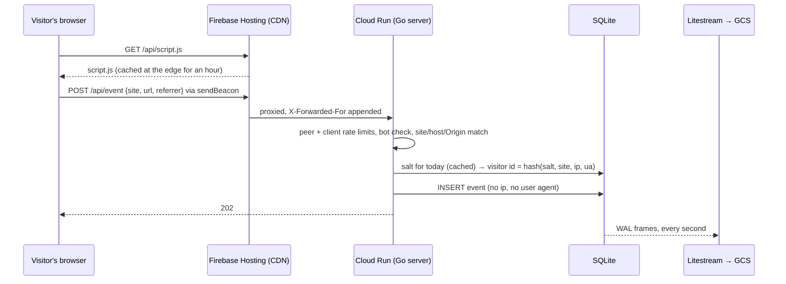
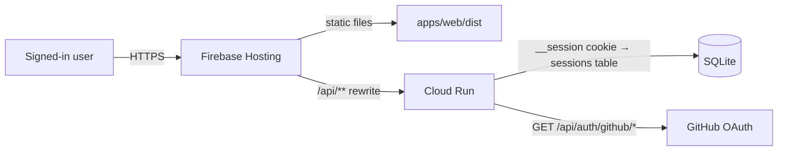
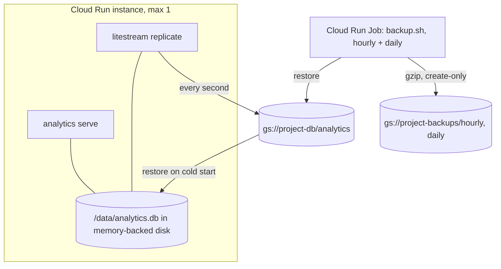

# Architecture

How the parts fit together, what talks to what, and where the data lives. The code is small
enough that this page and [PLAN.md](PLAN.md) are the whole design.

## The parts

| Part | Where | What it is |
|---|---|---|
| Server | `apps/server` | One Go binary: event ingestion, the statistics API, GitHub sign-in, the embedded tracking script and a CLI. Standard library routing, no CGO. |
| Database | SQLite via `modernc.org/sqlite` | One file in WAL mode. Migrations are embedded SQL files applied at start. |
| Tracker | `apps/tracker` → `apps/server/internal/script/script.js` | A 1 KB script built with esbuild and committed, so the binary serves it from memory. |
| Dashboard | `apps/web` | A static React single-page app. It only talks to `/api` on its own origin. |
| Replication | Litestream, `infra/docker` | Streams the SQLite file to a bucket every second and restores it on a cold start. |
| Backups | `infra/docker/backup.sh`, `infra/terraform/main/backup.tf` | A Cloud Run Job restores the replica hourly and daily and writes a gzipped file to a second bucket. |
| Infrastructure | `infra/terraform` | Project bootstrap, then Cloud Run, buckets, Secret Manager, Firebase Hosting, alerts and a dashboard. |

## A page view, end to end



The IP address exists only inside the request: it keys the rate limiters, resolves to a country
and goes into the hash. Nothing writes it down. [PRIVACY.md](PRIVACY.md) lists every stored field;
[BOTS.md](BOTS.md) lists the checks in order.

## The dashboard



- One origin. Hosting serves the built dashboard and rewrites `/api/**` to Cloud Run, so the
  session cookie is first-party and there is no CORS. The cookie is named `__session` because
  it is the only cookie Firebase Hosting forwards.
- Sign-in is OAuth with PKCE against GitHub. The server stores the GitHub account id and login,
  never a token, and keeps a SHA-256 of each session token. The allowlist is checked on every
  request.
- Every statistics query is a parameterised SQL statement over a whitelist of dimensions
  (`store.Dimensions`). Filters, periods and comparisons are parsed and validated in
  `internal/api` before they reach `internal/store`.

## Where the data lives



- The instance is the single writer, so `max_instance_count = 1`. Scale to zero is fine: the
  first request waits for the restore (a second or two).
- The replica is the primary durability mechanism; the standalone files are the defence against
  a damaged or deleted replica. With `require_replica = true` an empty replica stops the instance
  and fails the backup job instead of starting fresh. [DEPLOY.md](DEPLOY.md) has the runbook.
- Self-hosters get the same binary and scripts in `docker-compose.yml`, with any Litestream
  target (S3, GCS, a local path) or none.

## Where the limits are

| Threat | Where it is stopped |
|---|---|
| Floods from one address | `httpx.RateLimiter` keyed on the unforgeable upstream address first, then the client address, both parsed into canonical IPs. |
| Floods from many addresses | A global token bucket (`INGEST_RATE_LIMIT`), a bounded write queue (503 instead of piling up) and a database size cap (`MAX_DATABASE_MB`). |
| Fake events for a site | The site must exist, the page URL and `Origin` must be on its domain, text is cleaned, and one visitor is capped at about one event per second. |
| Cross-site requests to the API | Mutations need `application/json` (forms cannot send it, fetch triggers a preflight the API never approves); bodiless mutations check `Origin`. |
| Stolen session | Sessions are hashes with a 7-day sliding expiry; a removed user's sessions are deleted at their next request; `analytics sessions revoke` ends all of them. |
| Supply chain | Digest-pinned images, commit-pinned Actions, Trivy and CodeQL in CI, SBOM and signed provenance on releases, Dependabot on every ecosystem. |

## Request lifecycle inside the server

```
net/http server (timeouts, 16 KB header cap)
└── secure(): X-Robots-Tag, nosniff, Referrer-Policy, CSP, X-Frame-Options, HSTS
    └── jsonErrors(): 404/405 as JSON, Allow header kept
        └── ServeMux
            ├── POST /api/event          ingest.Handler (limits → bot → payload → site → store)
            ├── GET  /api/script.js      script.Handler (gzip, ETag, CDN cache headers)
            ├── /api/auth/*              limit() → auth.Service (config, login, callback, me, logout)
            ├── /api/sites/*             auth.Require → api.API (sites, stats, breakdown, heatmap, realtime, purge)
            └── GET  /healthz            store.Ping
```

Everything below the mux is a plain `http.Handler` with the store injected, which is what the
tests use: `internal/server` tests exercise the whole stack with an in-memory database.
