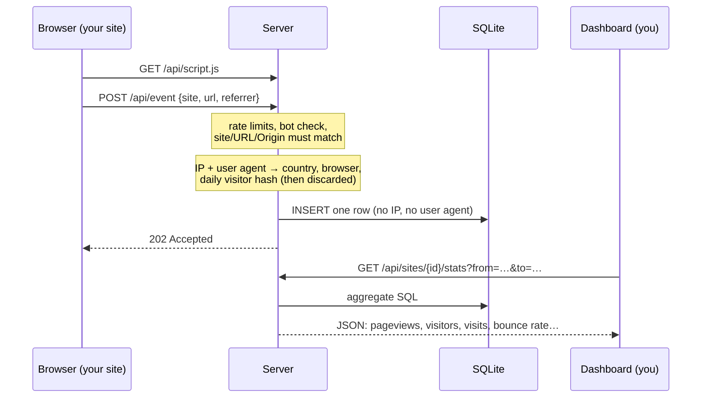

# Concepts

> **TL;DR** — The script sends one event per page view or custom event. The server keeps only
> coarse facts (path, referrer host, country, browser) plus an anonymous visitor hash that
> changes every day. Every number in the dashboard is computed from those rows when you ask for
> it. "Visitors" are counted per day, "visits" end after 30 minutes without activity, and a
> "bounce" is a visit with at most one page view.

**Read this if:** you are new to the project, or want to know exactly what a number in the
dashboard means. Time: about 10 minutes.

## How it works

1. **Collect.** The tracking script on your site sends a small JSON payload for each page view
   (including navigation in single-page apps), outbound link click and custom event.
2. **Filter and reduce.** The server drops bots and floods, checks that the event belongs to a
   registered site, and reduces the request to the fields in [privacy.md](privacy.md). The IP
   address and user agent are used once, in memory, and then discarded.
3. **Store.** One row per event in SQLite. There are no pre-computed aggregates.
4. **Query.** The dashboard asks the API for a site, a date range, a time zone and optional
   filters. The server computes the numbers with SQL.

## Glossary

### Metrics

| Term | Meaning |
|---|---|
| **Page view** | One `pageview` event: a page load, or a route change in a single-page app |
| **Custom event** | A named event you send with `data-mlz-event` or `mlz.track()`, optionally with properties (`plan: "pro"`) |
| **Visitor** | A distinct visitor id within the range. The id changes every UTC day, so a person who visits on three days counts as **three visitors** over that range. This is the price of not using cookies |
| **Visit** (session) | A series of events from one visitor with no gap longer than **30 minutes**. In a time series, a visit counts in the bucket where it started |
| **Bounce rate** | The share of visits with **at most one page view** |
| **Visit duration** | Time from the first to the last event of a visit, averaged over visits. A one-page visit lasts 0 s |
| **Views per visit** | Page views divided by visits |
| **Realtime visitors** | Distinct visitors in the last 5 minutes |
| **Goal** | A custom event or a page (path, `*` as a wildcard) you want visitors to reach. A goal's visitors are the distinct visitors who reached it; its completions are the matching events or page views |
| **Conversion rate** | A goal's visitors divided by all visitors in the period |

### Dimensions (what you can break down and filter by)

| Term | Meaning |
|---|---|
| **Page** (`path`) | URL path, without query string or fragment (`/blog/post`) |
| **Hostname** | The page's host, useful when one site spans subdomains |
| **Entry / exit page** | The first and last page of a visit |
| **Referrer** | The host of the page that linked to you. Empty means **direct**: typed, bookmarked, or the referrer was hidden. Links from your own domain are not referrers |
| **UTM source / medium / campaign** | Read from `utm_*` parameters in the page URL. They are attributed to the visit |
| **Country** | Two-letter ISO code, from a local DB-IP database. No city or region |
| **Browser / OS / device** | Derived from the user agent. Device is `desktop`, `mobile`, `tablet` or `other` |

How a filter applies depends on the kind of dimension (visitor, page or visit). See
[Statistics in the API reference](reference/api.md#statistics).

### Privacy and infrastructure

| Term | Meaning |
|---|---|
| **Site** | A domain you track, with a public **site id** used in the script tag. Subdomains of the domain are accepted |
| **Daily salt** | A random secret, replaced every UTC day. The visitor id is `SHA-256(salt, site id, IP, user agent)`. Once the salt is deleted, ids cannot be linked across days and the IP cannot be recovered |
| **`PROXY_HOPS`** | How many trusted proxies sit in front of the server. Needed to find the real client IP in `X-Forwarded-For`. See [configuration](reference/configuration.md#proxy_hops) |
| **Litestream** | A tool that continuously copies the SQLite file to object storage (GCS or S3), and restores it on start |
| **Comparison** | The previous period of the same length (`previous`), or the same dates a year earlier (`year`) |

## Why it is built like this

- **SQLite and one instance.** There is no database server to run, and backup is a file copy.
  It handles far more than personal traffic needs.
- **Cookie-free counting.** Nothing is stored on the visitor's device and no personal data is
  kept (see the [legal note](privacy.md#legal-note); not legal advice). The trade-off is that
  visitors cannot be followed across days.
- **No pre-aggregation.** Every filter combination works on raw rows, and the schema stays simple.

More in [decisions.md](decisions.md).

## Next steps

- [Getting started](getting-started.md): see it running in 10 minutes
- [Architecture](../ARCHITECTURE.md): where each part lives in the code
- [Privacy](privacy.md): the exact stored fields
