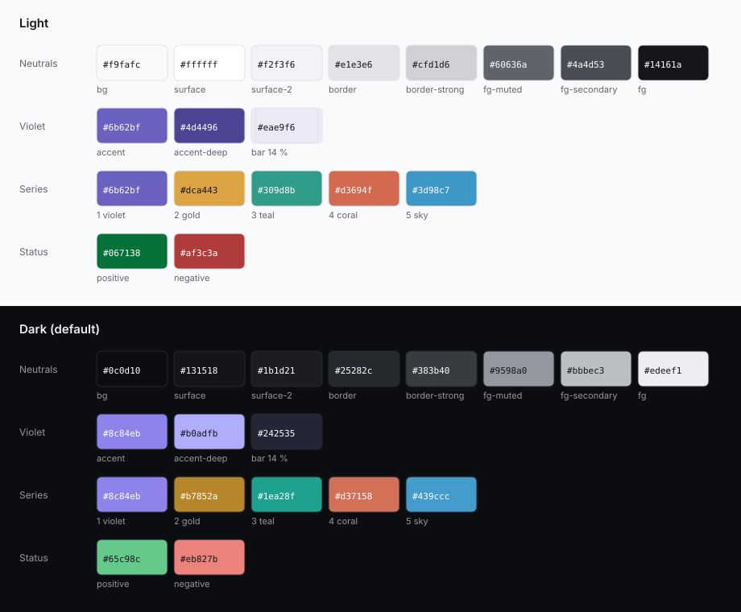

# Colours

> **TL;DR** — The dashboard is greyscale, and colour means data. mlz violet is the main data
> colour and the brand, so it also marks keyboard focus, text selection and the wordmark, and
> nothing else in the UI. Grey is the comparison, green and red only mean up and down, and five
> muted series colours (violet, gold, teal, coral, sky) are used in a fixed order when one chart
> compares categories. Every colour is a token in `apps/web/src/index.css`, defined for light and
> dark. The series colours are validated for colour vision deficiency: do not reorder or change
> them without checking again.

**Read this if:** you add a chart, a coloured state, or change a colour token. Time: about 10 minutes.

## The rule: colour means data

| Colour | Means | Never used for |
|---|---|---|
| Greys | Everything you click, select or read: buttons, menus, tabs, the period picker, surfaces, text | |
| Violet (`--accent`) | Your traffic: the main line and its area, bars in lists, the heatmap and map, the active KPI. Also the brand (wordmark dot), keyboard focus and text selection | Buttons, active tabs, badges, any other UI state |
| Grey (`--fg-muted`) in charts | The comparison: previous period (dashed), inactive sparklines | |
| Five series colours | Categories in one chart: top sources over time, the device split | A single-series chart, decoration |
| Green and red (`--positive`, `--negative`) | Up and down, with an arrow; the live dot; destructive actions | A series, a category |

The landing page (`routes/home.tsx`) is the one place that also uses violet as decoration
(eyebrows, separators, big numbers), because it introduces the brand. Its dashboard preview
still follows the up/down rule: the changes there are `<Delta>`s in green and red.

Why this rule: an analytics dashboard is read for its numbers, so the numbers get the only
colour on the screen. Primary buttons are already the text colour (`--primary: var(--fg)`), so the
UI stays quiet and a chart never competes with a control. Using the brand violet for data, rather
than a separate blue, keeps the product recognisably mlz where people look most.

## Roles and tokens

| Role | Token | Where it is used |
|---|---|---|
| Main data series and brand | `--accent`, `--series-1`, `--chart-1`, Tailwind `violet` | `traffic-chart.tsx` (line), realtime bars, `sparkline.tsx` (active KPI), `kpi-strip.tsx` (active marker), `brand-mark.tsx` |
| Area under the main line | `--chart-fill` (= `--accent`) | `traffic-chart.tsx`, a gradient from 28 % to 0 |
| Bars in ranked lists | `bg-violet/14`, `bg-violet/12` | `bar-list.tsx`, `goals-card.tsx` (`/14`) and `data-table.tsx` (`/12`) |
| Amount (one hue, light to dark) | `ramp()` mixes `--accent` into `--surface-2` | `heatmap.tsx`, `world-map.tsx` |
| Comparison | `--chart-2` (= `--fg-muted`), dashed | `traffic-chart.tsx`, inactive sparklines |
| Categories | `--series-1` … `--series-5` | `top-series-chart.tsx`, `proportion-strip.tsx` |
| Text in violet (links) | `--accent-deep` | links, landing page |
| Focus and selection | `--ring` (= `--accent`), `::selection` | `index.css` base layer |
| Up / down | `--positive` / `--negative` (and `--destructive`) | `delta.tsx`, the live dots (realtime, sidebar, `LiveDot` in `waiting-for-data.tsx`), destructive buttons, error notes |
| Surfaces and text | `--bg`, `--surface`, `--surface-2`, `--border`, `--border-strong`, `--fg`, `--fg-secondary`, `--fg-muted` | everywhere |

shadcn's own `accent` (Tailwind `bg-accent`, `text-accent`, `border-accent`) is **not** violet: it
is a 7 % text-colour tint for hovers (`--ui-accent`). Use `violet` or `accent-deep` when you mean
violet.

## The palette

Neutrals share mlz.no's blue-grey hue (OKLCH hue 265). Dark mode is the default; it sits a little
above black and keeps its text a touch below white, so nothing glows.

| Token | Light | Dark |
|---|---|---|
| `--bg` | `oklch(0.985 0.003 265)` · `#f9fafc` | `oklch(0.16 0.006 265)` · `#0c0d10` |
| `--surface` | `oklch(1 0 0)` · `#ffffff` | `oklch(0.195 0.007 265)` · `#131518` |
| `--surface-2` | `oklch(0.965 0.004 265)` · `#f2f3f6` | `oklch(0.232 0.008 265)` · `#1b1d21` |
| `--border` | `oklch(0.915 0.005 265)` · `#e1e3e6` | `oklch(0.275 0.009 265)` · `#25282c` |
| `--border-strong` | `oklch(0.86 0.007 265)` · `#cfd1d6` | `oklch(0.35 0.01 265)` · `#383b40` |
| `--fg-muted` | `oklch(0.5 0.012 265)` · `#60636a` | `oklch(0.68 0.012 265)` · `#9598a0` |
| `--fg-secondary` | `oklch(0.42 0.01 265)` · `#4a4d53` | `oklch(0.8 0.008 265)` · `#bbbec3` |
| `--fg` | `oklch(0.2 0.008 265)` · `#14161a` | `oklch(0.95 0.004 265)` · `#edeef1` |
| `--accent` | `#6b62bf` | `#8c84eb` |
| `--accent-deep` | `#4d4496` | `#b0adfb` |
| `--positive` | `oklch(0.48 0.13 152)` | `oklch(0.76 0.13 155)` |
| `--negative` | `oklch(0.52 0.15 25)` | `oklch(0.72 0.13 25)` |

The `theme-color` in `apps/web/index.html` and `THEME_COLOR` in `theme-provider.tsx` are the `--bg`
hex values; change all three together.

### Series colours

| Slot | Name | Light | Dark | Why it sits here |
|---|---|---|---|---|
| 1 | Violet | `#6b62bf` | `#8c84eb` | The main colour; the same as `--accent` |
| 2 | Gold | `#dca443` | `#b7852a` | Opposite violet on the colour wheel: the clearest pair for every kind of vision |
| 3 | Teal | `#309d8b` | `#1ea28f` | Cool again, so slots 1–3 are cool, warm, cool |
| 4 | Coral | `#d3694f` | `#d37158` | Warm, kept away from gold |
| 5 | Sky | `#3d98c7` | `#439ccc` | Last, so it is never next to violet (blue and violet merge for deuteranopes) |

They are muted on purpose (average OKLCH chroma 0.124, against 0.16 for the previous palette),
so charts read as calm, but they stay above the chroma floor of 0.10 where colours start to look
grey. No chart uses more than five (`SERIES = 5` in `top-series-chart.tsx`, `max={5}` on
`ProportionStrip`); a sixth value belongs in "Other", not in a new colour.

## Rules for using colour

- **One colour before many.** Most charts are violet plus grey. Use series colours only when a
  chart compares categories.
- **Fixed order, never cycled.** Slot *n* is always `--series-n`. The order is part of the colour
  vision check.
- **Colour follows the entity.** When a filter removes a series, the others keep their colour.
- **Never colour alone.** Every chart with two or more series has a legend; deltas have an arrow;
  status has a word or an icon. Gold is under 3:1 on white, so charts that use it also need the
  table view or visible labels.
- **Text stays in text colours.** Values and labels use `--fg`, `--fg-secondary` or `--fg-muted`,
  never a series colour; the coloured mark next to them carries the identity.
- **Status is not a series.** Green and red never stand for a category.
- **Tints for fills, not new colours.** A softer version of a colour is `color-mix()` or a Tailwind
  opacity (`bg-violet/14`), never a new hex.

## How the colours were checked

The series were searched in OKLCH and checked with a palette validator (OKLab ΔE ×100 between
colours, with protanopia and deuteranopia simulated by the Machado model) against `#ffffff` and
the dark `--surface` (`#131518`):

| Check | Target | Light | Dark |
|---|---|---|---|
| Neighbouring series, colour vision deficiency | ΔE ≥ 8 | 9.9 | 9.4 |
| First three series, every pair | ΔE ≥ 8 | 12.8 | 12.1 |
| All five, every pair (lines that cross) | ≥ 8 is ideal | 9.1 | 3.7 |
| Neighbouring series, normal vision | ΔE ≥ 15 | 21.8 | 17.9 |
| Lightness band | L 0.43–0.77 / 0.48–0.67 | pass | pass |
| Series under 3:1 against the surface | legend + table if any | gold (2.23) | none |
| Muted text on its surface | WCAG AA 4.5:1 | 6.0 | 6.3 |
| Muted text on a 14 % violet bar | WCAG AA 4.5:1 | 5.0 | 5.2 |

No five-colour palette passes "every pair" in dark mode, where the lightness band is narrow. That
is fine for stacked strips and lines, where neighbours matter, but a chart where any two of five
series can sit next to each other should also let the reader focus one (hover or legend).

The end-to-end tests run an axe scan on every page in the dark theme, the light theme and on
mobile (`apps/web/e2e`), which catches text contrast regressions. Colour vision checks are not
automated, so run them by hand when you change a series colour.

### Changing a colour

1. Change the value in both the light (`:root`) and dark (`[data-theme="dark"]`) blocks of
   `index.css`. Pick it in OKLCH, so lightness and chroma stay comparable.
2. Re-check the series in both modes against the surfaces above: the neighbour and three-colour
   gates, the lightness band, and contrast. Keep the order unless the check says otherwise.
3. Run `./scripts/verify.sh web e2e` for the axe scan.
4. Update the tables on this page and `palette.svg`, and add a line to `CHANGELOG.md`.

Research behind these choices

- [Linear](https://linear.app/now/how-we-redesigned-the-linear-ui) builds its themes from three
  inputs (base, accent, contrast) in LCH, a perceptually even colour space. The tokens here are
  chosen in OKLCH for the same reason.
- Restrained analytics dashboards (Vercel, Linear, Plausible) use grey plus one primary colour,
  with red or green only for status ([AdminLTE review](https://adminlte.io/blog/25-best-dashboard-design-examples-for-2026-real-products-principles/)).
  Plausible's main graph is a purple area chart, so violet reads as "traffic" in this niche.
- Dark themes should use dark grey rather than black (Material recommends `#121212`) and desaturated
  colours, which otherwise vibrate on dark surfaces ([Atmos](https://atmos.style/blog/dark-mode-ui-best-practices),
  [UX Planet](https://uxplanet.org/8-tips-for-dark-theme-design-8dfc2f8f7ab6)).
- Datawrapper: colours are told apart by lightness; more than three or four colours stop being
  read; pure pastels fail for colour-blind readers ([part 2](https://www.datawrapper.de/blog/colorblindness-part2),
  [part 3](https://www.datawrapper.de/blog/colorblindness-part3)).
- [IBM Carbon](https://carbondesignsystem.com/data-visualization/color-palettes/) applies its
  categorical order strictly, chosen for contrast between neighbours, and keeps status colours
  separate.
- [Tableau](https://www.tableau.com/blog/examining-data-viz-rules-dont-use-red-green-together):
  blue and purple are one of the pairs that collapse for deuteranopes, hence sky in the last slot.
- Observable 10 ([d3-scale-chromatic](https://d3js.org/d3-scale-chromatic/categorical)) is a modern
  default that starts blue, gold, red. Ours keeps a gold second but alternates cool and warm, with
  muted colours and violet first.

## Next steps

- [Dashboard development](dashboard.md): app primitives and where the charts live.
- `apps/web/src/index.css`: the tokens themselves.
- `apps/server/internal/devdata/demo/index.html` (`make dev`, <http://localhost:8081>): the palette and sample charts in
  both themes. It copies the tokens, so update it when you change one.
