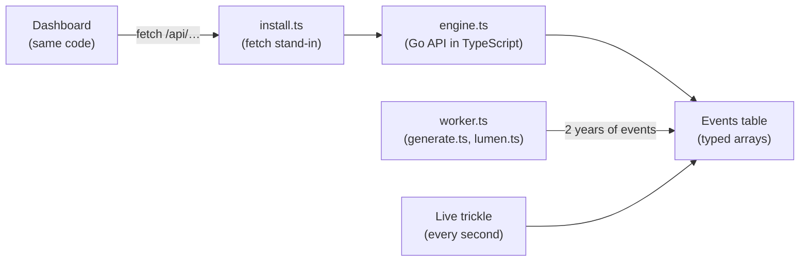

# Public demo

> **TL;DR** — `/demo/` is the real dashboard, built a second time with `vite build --mode demo`,
> that answers its own `/api` requests in the browser. A Web Worker generates two years of
> traffic for **Lumen**, a fictional product analytics company (`lumen.example`), always ending
> *now*, and `src/demo/engine.ts` answers every read endpoint the way the Go API does. A golden
> test runs the same requests against both and fails when they differ. No server, no sign-in,
> and nothing leaves the visitor's browser. `bun run dev:demo` runs it locally.

**Read this if:** you change the API's answers, the demo's data, or how the demo is built and
hosted. Time: about 10 minutes.

## What it is



| File (`apps/web/src/demo/`) | What it does |
|---|---|
| `install.ts` | Replaces `window.fetch` for same-origin `/api/` paths, turns CSV links into downloads, starts the worker, then a trickle of new visits so **Realtime** moves |
| `worker.ts` | Generates every site's history off the main thread and hands the tables over without copying |
| `sites.ts` | The demo sites (Lumen, Lumen Status), their goals, and how a backend is built from the tables |
| `lumen.ts` | The fictional sites: pages, sources, campaigns, launches, navigation and custom events |
| `generate.ts` | The traffic model: growth, weekly and yearly cycles, time zones, devices, sessions, spikes |
| `table.ts` | The events table: one row per page view or event, column by column, sessions assigned like `store.InsertEvent` |
| `engine.ts` | Every endpoint the dashboard reads, with the Go API's parameters, validation messages, JSON and metric rules. Writes answer `403 This is a read-only demo`, except goals, which can be added and removed for the visit |
| `tz.ts` | Time zone arithmetic that matches Go's `time.Date`, `AddDate` and `Format` |

Only the demo build imports `src/demo`: `main.tsx` loads it when `import.meta.env.MODE` is
`demo`, so the production bundle does not contain it (`check-size.mjs` checks both builds).

## The data

Lumen is a SaaS marketing site with a blog, docs on `docs.lumen.example`, and a separate status
page site. The model is meant to read like a real company's numbers:

- **Volume:** about 330 visits on a weekday two years ago, growing to about 1,000 now, with
  quieter weekends, a summer dip and a quiet Christmas, and day-to-day noise that drifts rather
  than jumps.
- **Who:** about 50 countries, each at its own local time (US traffic arrives in the European
  evening), and a realistic browser, OS and device mix; phones go up at weekends and from social
  links.
- **Where from:** search engines send people to answers (posts, docs, comparison pages), GitHub
  and Stack Overflow to the docs, social links to posts, review sites and AI assistants to
  pricing. AI assistants and some campaigns start partway through the history and grow.
- **Story:** a Hacker News front page about 14 months ago, a 2.0 launch about 7 months ago, a
  Product Hunt launch 10 weeks ago, another Hacker News post 19 days ago, a Reddit thread last
  week, and a weekly newsletter every Tuesday. So 7 days, 30 days and 12 months each show
  something.
- **Behaviour:** visitors move between pages by section (docs readers stay in the docs, pricing
  leads to sign-up), bounce and time on page depend on the page and the source, and custom
  events (`signup`, `trial-started`, `checkout`, `demo-requested`, `copy-code`, `docs-search`,
  `outbound-link`, …) carry properties.

The generator is deterministic for a seed, so everyone sees the same story; only *now* moves.
It takes about a second in a Web Worker and holds about a million rows in typed arrays.

> [!NOTE]
> Every name is made up and every domain ends in `.example` (reserved by RFC 2606). Page and
> campaign names avoid dates and months, because the data is always relative to today.

## Same answers as the server

`src/demo/testdata/` holds the contract:

| File | What |
|---|---|
| `requests.json` | About 80 requests: every period shape, interval, comparison, filter kind and dimension, visit metrics, heatmap, goals, realtime, CSV exports and the error cases |
| `events.json` | A small, fixed slice of Lumen traffic (written by `bun run demo:fixture`) |
| `golden.json` | The Go API's answers to those requests over those events |

`TestDemoGolden` (`apps/server/internal/api/demo_golden_test.go`) loads the events into a real
store, sends the requests and compares with `golden.json`. `src/demo/golden.test.ts` sends the
same requests to the demo engine and compares with the same file. Both run in `make verify`.

When you change the API on purpose:

```sh
UPDATE_GOLDEN=1 go test ./apps/server/internal/api -run TestDemoGolden   # new answers
cd apps/web && bun run test src/demo                                      # the demo must match
```

Then change `engine.ts` until it does. A new endpoint or parameter belongs in `requests.json`
too. If you change the generator in a way that should be covered, run `bun run demo:fixture`
and update the golden file.

## Running and building

```sh
cd apps/web
bun run dev:demo        # http://localhost:5173/demo/ with hot reload
bun run build           # both builds: dist/ and dist/demo/
bun run preview:demo    # serve dist/demo at http://localhost:4173/demo/
```

`vite.config.ts` gives the demo mode `base: "/demo/"` and `outDir: "dist/demo"`, and the router
takes its basename from `import.meta.env.BASE_URL`. `firebase.json` rewrites `/demo` and
`/demo/**` to `demo/index.html` before the dashboard's catch-all, so `make deploy-web` and the
Deploy workflow publish it with the dashboard, under the same headers.

The end-to-end tests run the demo build too (projects `demo` and `demo-mobile` in
`playwright.config.ts`, `e2e/demo.spec.ts`): every view, a filter, the light theme, read-only
writes, and an axe scan on every page.

## Next steps

- [Dashboard development](dashboard.md): the app the demo runs.
- [API reference](../reference/api.md): the endpoints the engine mirrors.
- [Concepts](../concepts.md): what each metric means.
