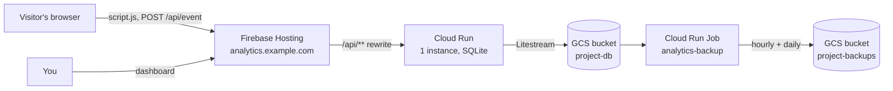

# Deploying to Google Cloud

> **TL;DR** — Two Terraform stacks (`bootstrap`, then `main`), one secret, DNS records, then
> `make deploy`. You end up with the dashboard on Firebase Hosting, the API on one Cloud Run
> instance, and SQLite replicated to GCS. It costs about $1 a month for personal traffic.
> Time: about an hour, mostly waiting for DNS and certificates.

**Read this if:** you want the same production setup as `analytics.mlz.no`. Self-hosting without
GCP? See [self-hosting.md](self-hosting.md). Day-to-day operations after the deploy are in the
[runbook](../operations/runbook.md).



The dashboard runs on Firebase Hosting, and Firebase rewrites `/api/**` to a single Cloud Run
instance, so the dashboard, API and tracking script share one origin. SQLite lives on the instance
and Litestream replicates it to a GCS bucket. The reasons are in [decisions.md](../decisions.md).

For personal traffic this stays inside the free tiers. The only steady cost is Litestream's writes
to GCS, which come to roughly $1 a month. The hourly and daily backups add a few cents.

## Prerequisites

- `gcloud`, signed in as an account that can create projects and use a billing account:
  `gcloud auth login && gcloud auth application-default login`
- Terraform ≥ 1.9, Docker with `buildx`, and Bun for the dashboard build (`mise install && bun install` gives you the pinned Terraform and Bun, plus the Firebase CLI as a dev dependency). Sign in to Firebase once with `bunx firebase-tools login`
- A domain whose DNS you control, e.g. `analytics.example.com`. Optionally a second, short host for the tracking script (see [Extra domains](#extra-domains))
- A **GitHub OAuth App** (Settings → Developer settings → OAuth Apps):
  - Homepage URL: `https://<domain>`
  - Authorization callback URL: `https://<domain>/api/auth/github/callback` (must match exactly)

## 1. Bootstrap: project, APIs, state bucket, budget

`infra/terraform/bootstrap` creates the GCP project, links billing, enables the APIs, creates the bucket for Terraform state and sets a monthly budget alert. It uses local state.

```sh
cd infra/terraform/bootstrap
cat > terraform.tfvars <<'EOF'
project_id      = "my-analytics"          # globally unique
billing_account = "012345-6789AB-CDEF01"  # gcloud billing accounts list
budget_currency = "USD"                   # must match the billing account's currency
monthly_budget  = 5
EOF
terraform init
terraform apply
```

The project has `deletion_policy = "PREVENT"`. To delete it, change that first.

**Move the bootstrap state off your machine.** The state starts out local, and it is the only
record of the project, billing link and budget. After the first `apply`, copy it into the state
bucket (the `main` stack keeps its state there under `main/`; this one goes under `bootstrap/`):

```sh
cp terraform.tfstate ~/terraform.tfstate.bootstrap-backup   # safety copy first
cp backend.tf.example backend.tf
terraform init -migrate-state -backend-config=bucket=<project_id>-tfstate
terraform plan   # must say: No changes
```

`backend.tf` is git-ignored on purpose: on a first run the bucket does not exist yet, so a committed
`gcs` backend would break `terraform init` for everyone else. On another machine, copy
`backend.tf.example` to `backend.tf` and run
`terraform init -backend-config=bucket=<project_id>-tfstate`. Delete the local `terraform.tfstate*`
files once `gcloud storage ls gs://<project_id>-tfstate/bootstrap/` shows the state.

## 2. Main: Cloud Run, database bucket, secret, Firebase Hosting

```sh
cd infra/terraform/main
cp terraform.tfvars.example terraform.tfvars   # set project_id, domain, extra_domains (optional), github_client_id, allowed_github_users
terraform init -backend-config=bucket=<project_id>-tfstate
terraform apply
```

The first apply deploys a placeholder image. `make deploy` replaces it, and Terraform ignores image changes from then on.

Outputs:

| Output | Use |
|---|---|
| `public_url` | Dashboard URL. The OAuth callback is `<public_url>/api/auth/github/callback`. |
| `dns_records` | Records to create for `domain` and `extra_domains` (usually one CNAME each to `<site>.web.app`). |
| `image_repo` | Where `make deploy` pushes images. |
| `cloud_run_url` | The service's own `run.app` URL (Firebase Hosting proxies to it), for debugging. |
| `firebase_site`, `firebase_default_url` | The Hosting site and its `web.app` URL. |
| `dashboard_url`, `logs_url` | The operations dashboard and the warnings/errors log query. |

Show them again at any time with `terraform output`.

## 3. GitHub client secret

Terraform creates the secret with a placeholder, so the real value never ends up in Terraform state. Add it with a hidden prompt (macOS):

```sh
osascript -e 'text returned of (display dialog "GitHub client secret" default answer "" with hidden answer)' \
  | tr -d '\r\n' \
  | gcloud secrets versions add github-client-secret --data-file=- --project <project_id>
```

On other systems, run `gcloud secrets versions add github-client-secret --data-file=- --project <project_id>` in a terminal, paste the secret and press Ctrl-D.

Avoid a trailing newline, because it becomes part of the secret. Cloud Run reads `latest`, so the new version is used from the next deploy or cold start.

To rotate the secret later, see the [runbook](../operations/runbook.md#rotate-the-github-client-secret).

## 4. DNS

Create the records from `terraform output dns_records` at your DNS provider. Firebase verifies the domain and issues a TLS certificate on its own, which usually takes from a few minutes up to about an hour. Until then, the dashboard is reachable at `https://<site>.web.app`, but sign-in only works on the domain configured in the OAuth App.

### Extra domains

`extra_domains` serves the same site on more hostnames, for example a short, neutral host for the
tracking script next to a readable dashboard host:

```hcl
domain        = "analytics.example.com"   # dashboard, sign-in, PUBLIC_URL
extra_domains = ["t.example.com"]         # same content, script and events
```

Ad blockers often filter hostnames that contain "analytics", so sites may load
`https://t.example.com/api/script.js` instead. Do not redirect one host to the other: a redirect
breaks `POST /api/event` and `sendBeacon`. Sign-in only works on `domain`, because a GitHub OAuth App
has one callback URL. Add one CNAME per host from `terraform output dns_records`.

To make the dashboard's "Tracking code" page hand out the short host, build it with
`TRACKER_ORIGIN`: `make deploy-web TRACKER_ORIGIN=https://t.example.com` (it becomes
`VITE_TRACKER_ORIGIN` for Vite). Without it the snippet uses the dashboard's own origin.

**Moving an existing domain.** If the host you used as `domain` before becomes an extra domain, move
it in state first so Terraform does not destroy and re-issue its certificate:

```sh
terraform state mv 'google_firebase_hosting_custom_domain.this[0]' 'google_firebase_hosting_custom_domain.extra["t.example.com"]'
terraform plan   # should only add the new primary domain and update the service
```

## 5. Deploy

```sh
gcloud auth configure-docker <region>-docker.pkg.dev   # once
make deploy                                            # or: make deploy-server / make deploy-web
```

- `deploy` (and `deploy-server` or `deploy-web` on their own) runs the quality gate
  (`scripts/verify.sh`) once, and refuses to continue unless the working tree is clean (untracked
  files included), on `main` and identical to `origin/main` (it fetches to compare, so it needs
  the network). `FORCE=1 make deploy` skips those three checks for an emergency fix; the quality
  gate still runs.
- `deploy-server` builds a `linux/amd64` image, pushes it as `server:<git sha>` (with `-dirty` for
  uncommitted or untracked changes) and rolls out a new Cloud Run revision and backup job image.
- `deploy-web` builds `apps/web/dist` and publishes it to Firebase Hosting. Server first, then
  web, so a new dashboard never goes live before the API it needs.

Override `PROJECT`, `REGION` or `SERVICE` on the command line if yours differ. `SERVICE` and
`REGION` are also written into `apps/web/firebase.json` (the `/api/**` rewrite); change both.

After the first deploy has data, set `require_replica = true` in `terraform.tfvars` and apply.
From then on an instance refuses to start from an empty replica, and the backup job treats an
empty replica as a failure, so a lost replica becomes an alert instead of a quiet fresh start.
Leave it `false` for the very first deploy, when the replica is empty by design.

## 6. Verify

```sh
curl -s -o /dev/null -w '%{http_code}\n' https://<domain>/api/auth/me      # 401 = API reachable through Firebase
curl -sI https://<domain>/api/script.js | head -1                          # 200
gcloud run services logs read analytics --region <region> --project <project_id> --limit 30
```

The logs should show Litestream either restoring from the bucket or reporting "no backup found, starting fresh", followed by "replicating to".

Then sign in at `https://<domain>`, add a site and embed the tracking snippet shown in the dashboard. If you use an extra domain for the script, replace the host in the snippet with it.

**Check `PROXY_HOPS`.** Firebase Hosting → Cloud Run is expected to be 2. Visit a tracked site
yourself and check that the realtime view shows your country. If countries are wrong or every
visitor looks the same, follow the
[runbook](../operations/runbook.md#wrong-countries-or-every-visitor-looks-the-same).

<details>
<summary>Why the <code>run.app</code> URL stays public</summary>

The service must stay reachable on its `run.app` URL, because Firebase Hosting rewrites go through
it (disabling the default URL breaks them). A request sent there directly can forge
`X-Forwarded-For`. The server therefore also rate-limits by the address Cloud Run itself saw (the
rightmost entry), which cannot be forged.
</details>

**Abuse limits and alerts.** `ingest_rate_limit` (default 50 events/s) and `max_database_mb`
(default 200) bound how fast and how far a flood can grow the database, which on Cloud Run lives in
the instance's 512 MiB of memory. Set `alert_email` to be told about memory pressure, load
shedding, failed backups, server errors and (with `domain` set) downtime.

The backup job (`analytics-backup`) uses a placeholder image after the first `terraform apply`, so
it fails, and sends an alert, until the first `make deploy`.

## After the deploy

Monitoring, logs, backups, restoring, secret rotation, spam clean-up and known trade-offs are in the
[runbook](../operations/runbook.md). `terraform output dashboard_url` and `terraform output logs_url`
open the operations dashboard and the log query; all outputs are listed under
[step 2](#2-main-cloud-run-database-bucket-secret-firebase-hosting).

## Troubleshooting

| Symptom | Cause / fix |
|---|---|
| `billingbudgets.googleapis.com API requires a quota project` | User credentials need a quota project. The bootstrap routes the budget through a provider with `billing_project` set. Re-run `apply` once the project exists. |
| `PERMISSION_DENIED … CONSUMER_INVALID` right after creating the project | Permissions on the new project are still propagating. Wait a minute and retry. |
| `go mod download` segfaults during `make deploy` on Apple Silicon | The Go toolchain crashes under amd64 emulation. The Dockerfile cross-compiles on the build platform (`--platform=$BUILDPLATFORM`). Make sure you're on the current Dockerfile. |
| `Secret Payload cannot be empty` | stdin wasn't a terminal (e.g. a non-interactive shell). Use the hidden-prompt command above. |
| Sign-in fails with `redirect_uri` mismatch | The OAuth App's callback URL must be exactly `https://<domain>/api/auth/github/callback`. |
| `Location 'europe-north1' is not a valid location` creating a Cloud Scheduler job | Cloud Scheduler is not available in every region. The backup schedules use `scheduler_region` (default `europe-west1`) and still trigger the job in `region`. |
| `/healthz` returns 404 on the `run.app` URL | Cloud Run reserves paths ending in `z` on its public URL. The in-container startup and liveness probes still work; from outside, use `/api/auth/me` (401) as the health signal, which is also what the uptime check does. |
| The service starts but the dashboard is empty, and the log says "no backup found" | The replica is empty. With `require_replica = true` the instance would have refused to start; follow [Restore the database from a backup](../operations/runbook.md#restore-the-database-from-a-backup). |

## Next steps

- [Runbook](../operations/runbook.md): what to check now and when something goes wrong
- [Tracking your site](tracking.md)
- [Configuration](../reference/configuration.md)
